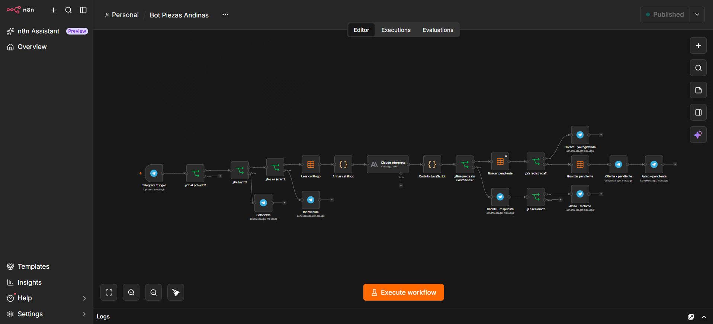
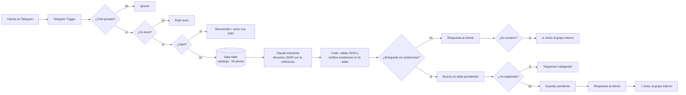
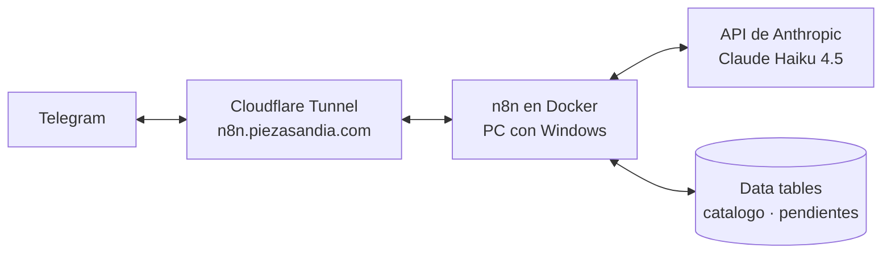
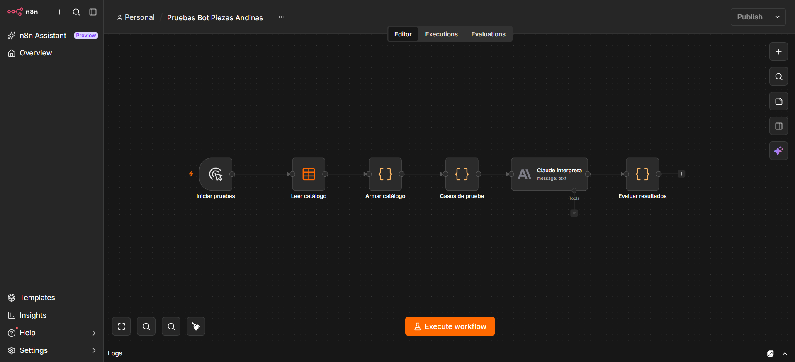

# 🤖 Bot de atención al cliente con IA — Piezas Mecánicas Andinas

Chatbot de Telegram (**@Piezass_bot**) que atiende a los clientes de una tienda **ficticia** de piezas mecánicas en Colombia. Entiende texto libre, consulta un catálogo, responde sin inventar precios ni plazos, registra las piezas sin existencias y avisa al equipo interno de los reclamos y las solicitudes pendientes.

Construido con **n8n (autoalojado en Docker)**, **Claude Haiku 4.5 (API de Anthropic)**, **Telegram** y **Cloudflare Tunnel**.

---

## Qué hace

| El cliente escribe… | El bot… |
|---|---|
| "¿Tienen rodamiento 6205?" (hay existencias) | Confirma y pide cantidad, ciudad y fecha |
| "Busco rodamiento 6305" (sin existencias) | Avisa que no hay, **registra la solicitud** y notifica al equipo 🔔 |
| La misma pieza otra vez | Responde "seguimos trabajando" (no la duplica) |
| "Mi pedido llegó roto" | Pide número de pedido y fotos, y **alerta al equipo** ⚠️ |
| Pregunta técnica | Indica que un técnico confirmará (no inventa medidas) |
| Foto, audio o sticker | Pide que escriba el mensaje en texto |
| Mensajes en el grupo interno | Los ignora |

## Así se ve en n8n



## Arquitectura



**Infraestructura**



## Decisiones de diseño

- **La IA interpreta, el código decide.** Un solo llamado a Claude identifica la intención, la pieza y su referencia exacta en el catálogo, y redacta la respuesta en JSON. Después, un nodo de código **verifica las existencias directamente en la tabla `catalogo`** y corrige la respuesta si la IA se equivocó. Así la disponibilidad nunca depende solo del modelo.
- **Catálogo en una tabla** (50 piezas en 10 categorías), no en el prompt: se actualizan existencias o se agregan piezas sin tocar el flujo.
- Este diseño reemplazó uno anterior de clasificador + Switch + 3 modelos, con menos costo y menor latencia.
- **Reglas anti-alucinación en el prompt:** la IA no inventa precios, plazos ni medidas, y las referencias parecidas no cuentan (6312 ≠ 6305).
- **Salida robusta:** un nodo Code limpia el JSON y, si falla el parseo, devuelve una respuesta segura por defecto.
- **Sin duplicados:** antes de registrar una pieza pendiente, el flujo busca si el mismo cliente ya la había pedido.
- **Costo bajo:** n8n autoalojado (gratis) y un modelo económico (Haiku 4.5). Solo se paga el dominio y el consumo de la API.

## Resultados de las pruebas

Set de 30 mensajes etiquetados a mano (búsquedas con y sin existencias, referencias inexistentes, reclamos, consultas técnicas y otros), ejecutado con un workflow de evaluación en n8n (`Pruebas Bot Piezas Andinas`) que lee el mismo catálogo. Detalle y metodología en [pruebas/resultados.md](pruebas/resultados.md); casos uno por uno en [pruebas/casos.csv](pruebas/casos.csv).

| Métrica | Resultado |
|---|---|
| Intención correcta | 100 % (30/30) |
| Disponibilidad correcta, resultado final | 100 % (18/18) |
| Disponibilidad correcta, solo la IA | 89 % (16/18) |
| Correcciones hechas por el código | 2 |
| Tiempo total de las 30 pruebas | ~55 s (~1,8 s por mensaje) |

Las 2 correcciones fueron referencias que no existen en el catálogo (6312 y 6209): la IA no marcó la disponibilidad y el código la fijó en "no disponible". Esto demuestra el valor de que el código, y no la IA, decida las existencias.

Workflow de evaluación (al terminar, envía el resumen al grupo interno de Telegram):



## Estructura del repositorio

```
├── README.md            ← esta página
├── pruebas/
│   ├── casos.csv        ← las 30 pruebas: esperado vs. obtenido
│   └── resultados.md    ← metodología, métricas y limitaciones
├── catalogo/
│   └── catalogo.csv     ← catálogo ficticio de 50 piezas
├── workflow/            ← workflows de n8n exportados (sin credenciales)
└── capturas/            ← imágenes del flujo y del bot funcionando
```

## Stack

- **n8n** (autoalojado, Docker Desktop, volumen persistente)
- **Claude Haiku 4.5**, vía API de Anthropic
- **Telegram Bot API** (cliente + grupo interno de avisos)
- **n8n Data Tables** (`catalogo` con 50 piezas y `pendientes`)
- **Cloudflare Tunnel** con dominio propio (URL fija, sin abrir puertos)

## Cómo ejecutarlo

1. Levantar n8n:
   ```bash
   docker run -d --name n8n --restart unless-stopped -p 5678:5678 \
     -e WEBHOOK_URL=https://<tu-dominio>/ -v n8n_data:/home/node/.n8n n8nio/n8n
   ```
2. Exponerlo con Cloudflare Tunnel: `cloudflared tunnel run <nombre-del-tunel>`
3. Importar los workflows de la carpeta [`workflow/`](workflow/) en n8n.
4. Crear las credenciales de **Telegram** (token de @BotFather) y **Anthropic** (API key).
5. Crear las data tables `catalogo` (`referencia`, `categoria`, `existencias`; datos en [`catalogo/catalogo.csv`](catalogo/catalogo.csv)) y `pendientes` (`chat_id`, `pieza`, `mensaje`).
6. Cambiar el ID del grupo interno en los nodos "Aviso - reclamo" y "Aviso - pendiente".
7. Publicar el workflow.

## Privacidad

El bot informa en la bienvenida que el nombre y los mensajes del cliente se usan solo para atender su solicitud, conforme a la **Ley 1581 de 2012** (Colombia). El negocio y el catálogo son ficticios.

## Limitaciones y siguientes pasos

- Funciona mientras el equipo anfitrión, Docker y el túnel estén encendidos (se podría migrar a un VPS).
- Con cientos de referencias, el catálogo completo ya no cabría bien en el prompt: convendría filtrarlo por categoría antes de enviarlo a la IA.
- Posibles mejoras: lectura de fotos de piezas, canal de WhatsApp y panel de métricas.

## Autor

**Yerson Díaz** · [LinkedIn](https://www.linkedin.com/in/yerson-diaz-a78b5b261/) · [GitHub](https://github.com/yayumba)
